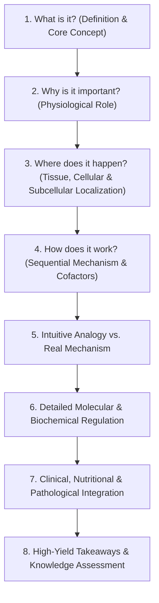

# Global Academic Writing, Language and Citation Standard
**Global Health Knowledge Hub**
*Applies permanently to: Anatomy, Physiology, Biochemistry, Metabolism, Functional Nutrition & Dietetics, Clinical Sciences, and all future educational chapters.*

---

## 1. Executive Summary & Purpose

The Global Health Knowledge Hub serves a diverse global audience of healthcare professionals, biomedical researchers, medical students, and undergraduate learners, with dedicated first-class support for English and Bengali (`bn`) speakers (including students in Bangladesh).

To deliver a world-class, rigorous, and accessible learning experience, all educational content across every academy must adhere to this unified **Academic Writing, Language and Citation Standard**.

---

## 2. Vancouver-Style Numeric Citation Standard

### 2.1 Compact Numbered In-Text Citations
1. **Numeric System**: Use Vancouver-style numeric brackets: `[1]`, `[2]`, `[3]`, etc.
2. **No Paragraph Clutter**: Never display raw URLs, long external hyperlinks, publisher cards, or bibliographic strings inside main chapter paragraphs.
3. **Placement**: Place compact numbered citations at the end of a supported paragraph or coherent group of scientific statements. Do not insert citations after every individual sentence unnecessarily.
4. **Substantiation**: Key clinical recommendations, quantitative biochemical values (e.g., enzyme $K_m$, renal thresholds, normal laboratory reference ranges), and contested scientific findings must be supported with structured citations.
5. **Sequential Numbering**: References are assigned numbers strictly in order of their first appearance within the chapter.
6. **Reuse**: When the same source is cited again in subsequent sections or paragraphs, the identical number is reused.
7. **Multiple Citations**: Support grouped citations formatted ascendingly with commas, e.g., `[1, 3]` or `[1, 2, 4]`.
8. **Structured Data**: Bibliographic references are stored in structured schema (`LessonReference[]`) with full metadata (`id`, `authors`, `title`, `organization`, `year`, `url`, optional `doi`).

### 2.2 Two-Way Clickable Navigation
1. **Interactive Citations**: Every inline citation number `[1]` is an accessible, clickable interactive control.
2. **Forward Jump**: Clicking `[1]` smoothly scrolls to Reference 1 in the End-of-Chapter References section, moves DOM focus to the reference card, and activates a subtle visual target highlight.
3. **Return-to-Citation Control**: Each reference entry in the bibliography contains a dedicated return control (`Return to citation [1]` / `উদ্ধৃতিতে ফিরে যান [১]`). Clicking it returns the learner directly to their exact reading position in the chapter text.
4. **Scoped Anchor IDs**: All anchor IDs are chapter-scoped to avoid collisions:
   - In-text citation: `cite-${chapterId}-${refNumber}-${instanceId}`
   - End-of-chapter reference: `ref-${chapterId}-${refNumber}`
5. **Route & History Preservation**: In-app navigation uses history replacement / hash updates without unmounting components or disrupting React Router state.
6. **Bilingual Consistency**: The exact same numbering sequence applies identically across English and Bengali views.

---

## 3. Simple International English Guidelines

All educational English must be written in clear, direct, and accessible international English tailored for non-native English speakers, including South Asian and Bangladeshi students:

1. **Familiar Vocabulary**: Prefer clear, familiar words over needlessly complex, Latinate academic phrasing (e.g., use "starts" or "initiates" rather than "commences"; "break down" alongside "hydrolyze").
2. **Sentence Length**: Use short-to-medium sentences (15–25 words). Break convoluted compound clauses into logical steps.
3. **Define on First Introduction**: When introducing technical or specialized terminology (e.g., *steatosis*, *allosteric modulation*, *gluconeogenesis*), define it in plain English immediately upon first mention.
4. **Never Compromise Accuracy**: Scientific precision must never be compromised. Do not replace essential anatomical or biochemical terms with vague colloquialisms (e.g., retain *pyruvate dehydrogenase*, *troponin C*, *Hounsfield unit*), but explain what they mean and do.
5. **Step-by-Step Logic**: Break biological pathways and physiological cascades into distinct sequential steps:
   - *What happens?*
   - *Where does it happen?*
   - *Why does it happen?*
   - *What happens next?*
6. **Analogies vs. Mechanism**: Use intuitive everyday analogies to give learners an initial intuitive grasp, but always explicitly differentiate the teaching model from the true biochemical mechanism.
7. **Big Picture First**: For complex metabolic networks, first explain the macroscopic physiological purpose before diving into enzymatic active sites and cofactor requirements.
8. **Tone**: Maintain an encouraging, professional, and intellectually rigorous academic tone across Foundation, Academic, and Advanced learning tiers.

---

## 4. Bengali Language Quality Standard (`বাংলা মানদণ্ড`)

1. **Natural, Scientific Bengali**: Avoid stiff, mechanical literal translations. Write flowing, scientifically articulate Bengali that reads like an authoritative popular science text or medical lecture.
2. **Dual-Term Pairing**: On first introduction of technical terms, pair the recognized English term alongside the Bengali translation:
   - e.g., *গ্লাইকোলাইসিস (Glycolysis)*, *অস্থিমজ্জা (Bone Marrow)*, *হিমোগ্লোবিন (Hemoglobin)*.
3. **Step-by-Step Clarity**: Explain complex molecular and anatomical phenomena with clear Bengali grammatical flow.
4. **Depth Parity**: The Bengali text must match the exact scientific depth, mechanistic rigor, and learning objectives of the English version.
5. **Consistent Terminology**: Ensure standard terminology remains unified across all chapters and academy subjects.

---

## 5. Educational Chapter Pedagogical Structure

For every major biological pathway, anatomical region, or clinical phenomenon, chapters should follow this structured educational progression:



### Learning Depth Tiers
- **Foundation**: Essential concepts, physiological logic, core terminology, intuitive diagrams, and everyday health applications.
- **Academic**: Standard undergraduate and medical curriculum scope, complete multi-step reaction sequences, regulatory enzymes, cofactors, and diagnostic biomarkers.
- **Advanced / Research**: Molecular genetics, structural biochemistry, post-translational modifications, flux dynamics, pharmacology, and current literature citations.

---

## 6. Component Architecture & Usage

### 6.1 `NumberedCitation` Component
Used to render inline Vancouver citation badges in text or at the end of sections:

```tsx
import { NumberedCitation } from '../../components/citations'

<NumberedCitation
  chapterId={lesson.id}
  referenceIds={['lehninger-biochem-8e-ch22', 'harpers-biochem-32e-ch31']}
  citationMap={citationMap}
  instanceId="sec-glycolysis-step1"
  locale={lang}
/>
```

Renders:
`[1, 2]` (or `[১, ২]` in Bengali), with clickable anchors linking to `#ref-${chapterId}-1` and `#ref-${chapterId}-2`.

### 6.2 `EndOfChapterReferences` Component
Placed at the end of the chapter after all didactic material, diagrams, and assessments:

```tsx
import { EndOfChapterReferences } from '../../components/citations'

<EndOfChapterReferences
  chapterId={lesson.id}
  citationMap={citationMap}
  locale={lang}
/>
```

Renders:
- Vancouver ordered reference list (`[1]`, `[2]`, ...).
- Authors, Year, Italic Title, Organization.
- Verified publisher `Open source` link and `DOI` link.
- Two-way `Return to citation` button navigating back to the reader's exact position.
- Regulatory and educational disclaimer.

### 6.3 Inline Paragraph Citation Tokens
Educational paragraph strings can include optional inline tokens:
```typescript
'Hexokinase catalyzes the initial phosphorylation [cite:lehninger-biochem-8e-ch22], preventing glucose from diffusing out of the hepatocyte.'
```
The renderer automatically converts `[cite:id]` into a live, interactive `NumberedCitation` component.

---

## 7. Cross-Academy Scientific Concept Links

Cross-academy concept exploration links (e.g., links to *Ovary*, *Insulin Resistance*, *Glycolysis*, *LH/FSH*, *Ketone Bodies*) represent conceptual knowledge graphs and are **never** to be conflated with bibliographic citations. Concept navigation and citation referencing remain strictly distinct features.
